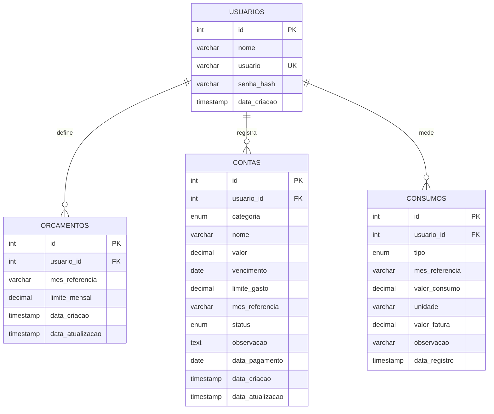

# Especificação Técnica do Sistema FLUXO (spec.md)

> **Versão:** 1.4.0  
> **Status:** Sistema totalmente implementado, polido e funcional  
> **Ambiente de referência:** PHP 8.2+ / MySQL 10.4+ (MariaDB) / XAMPP / Apache

## 1. Objetivo

O **FLUXO** é uma aplicação web destinada a apoiar pessoas e famílias no gerenciamento das despesas domésticas e no acompanhamento consciente do consumo de recursos essenciais, como água e energia elétrica. Seu objetivo é centralizar as contas residenciais em um ambiente intuitivo e seguro, permitindo acompanhar o orçamento mensal, identificar despesas próximas do vencimento ou acima dos limites definidos e tomar decisões financeiras mais informadas.

A proposta é substituir planilhas complexas e ferramentas excessivamente burocráticas por uma experiência acolhedora, com navegação fluida, indicadores visuais, avisos contextuais e relatórios históricos. Assim, o morador consegue compreender com facilidade como estão as contas e o consumo da residência durante o mês.

O sistema busca resolver dificuldades comuns, como:
- Falta de percepção sobre quanto do orçamento mensal já está comprometido;
- Desconhecimento das contas pendentes ou próximas do vencimento;
- Insegurança sobre quanto ainda é possível gastar até o fim do mês;
- Dificuldade para identificar aumentos repentinos no valor de uma conta variável;
- Falta de histórico e de visão percentual sobre o aumento ou a redução do consumo de água (litros/m³) e energia (kWh);
- Sensação de sobrecarga causada por sistemas com aparência bancária fria e excessivamente burocrática.

Para atender a essas necessidades, o FLUXO oferece:
- **Painel inicial doméstico:** saudação e visão geral da situação financeira do mês;
- **Painel de orçamento mensal:** exibição do teto familiar, valor comprometido, saldo disponível e barra de progresso com os estados Confortável, Atenção ou Ultrapassado;
- **Avisos contextuais automáticos:** alertas sobre limites atingidos, vencimentos próximos e variações anormais de consumo;
- **Gestão de contas:** cadastro, consulta, edição e exclusão de despesas nas categorias Água, Energia, Internet, Aluguel, Streaming e Outras despesas, com status e limites individuais opcionais;
- **Acompanhamento de consumo:** registro manual das medições de água e energia, cálculo da variação percentual em relação ao mês anterior e gráficos de linha;
- **Relatórios e gráficos:** distribuição de despesas por categoria, evolução mensal dos gastos e comparativo físico de consumo.

## 2. Usuários

O FLUXO possui um único perfil de usuário planejado e implementado: o **Usuário Cadastrado**. Não existem perfis administrativos, de suporte ou níveis hierárquicos adicionais no escopo do sistema.

### Permissões do Usuário Cadastrado

O usuário cadastrado pode:
- Criar sua própria conta de acesso, realizar login e encerrar a sessão (logout);
- Consultar seu nome e identificador de usuário (`usuario`);
- Cadastrar, consultar, visualizar detalhes, editar e excluir suas próprias contas e despesas;
- Alternar o status de suas contas entre pendente e paga, informando a data de quitação;
- Definir e consultar tetos de orçamento mensal para qualquer mês de referência;
- Registrar medições físicas de consumo de água e energia, consultar o histórico e excluir seus próprios registros;
- Visualizar avisos contextuais, gráficos de evolução e relatórios analíticos gerados exclusivamente a partir de seus dados.

### Isolamento dos dados

O isolamento é garantido pela camada de backend em todas as operações SQL. Toda consulta de leitura, inserção, alteração ou exclusão (`SELECT`, `INSERT`, `UPDATE`, `DELETE`) nas tabelas `orcamentos`, `contas` e `consumos` utiliza obrigatoriamente o filtro `WHERE usuario_id = :uid`, sendo `:uid` obtido da sessão autenticada (`$_SESSION['user_id']`). O sistema rejeita e neutraliza tentativas de manipulação de parâmetros destinadas a acessar registros de outros usuários.

## 3. Casos de uso principais

| Identificador | Caso de uso | Situação no projeto | Descrição resumida |
|---|---|---|---|
| **UC01** | Cadastrar usuário | Implementado | O visitante informa nome, nome de usuário único e senha confirmada para criar sua conta com senha criptografada. |
| **UC02** | Realizar login e logout | Implementado | O usuário autentica-se com nome de usuário e senha e encerra a sessão quando desejar. |
| **UC03** | Cadastrar uma conta | Implementado | O usuário registra uma despesa informando categoria, nome, valor, vencimento, mês de referência, limite opcional e observação. |
| **UC04** | Consultar, editar e excluir contas | Implementado | O usuário lista suas contas com filtros por mês e status, acessa detalhes e edição ou remove um registro após confirmação. |
| **UC05** | Marcar uma conta como paga | Implementado | O usuário alterna o status da conta entre pendente e paga, com registro da data de quitação. |
| **UC06** | Definir e consultar o orçamento mensal | Implementado | O usuário define ou reajusta o teto de gastos familiar para o mês selecionado e acompanha o saldo disponível. |
| **UC07** | Registrar consumo de água e energia | Implementado | O usuário registra a leitura física do medidor (`L`, `m³` ou `kWh`) e o valor faturado no mês. |
| **UC08** | Consultar histórico e variação de consumo | Implementado | O usuário analisa a tabela histórica e os gráficos comparativos, com indicação percentual de aumento ou redução em relação ao mês anterior. |
| **UC09** | Consultar dashboard, avisos e relatórios | Implementado | O usuário acessa a visão geral das contas, recebe alertas contextuais e consulta gráficos de distribuição e evolução financeira. |

## 4. Requisitos funcionais (RF)

- **RF01:** O sistema deve permitir que uma pessoa crie uma conta de usuário informando nome, nome de usuário único (`usuario`), senha e confirmação de senha, armazenando a senha em formato de hash criptográfico. *(Implementado)*
- **RF02:** O sistema deve autenticar usuários cadastrados por meio de nome de usuário e senha válidos, rejeitando tentativas inválidas com mensagens genéricas e seguras. *(Implementado)*
- **RF03:** O sistema deve permitir o encerramento da sessão ativa (logout) e bloquear o acesso direto a todas as rotas privadas quando o usuário não estiver autenticado, redirecionando-o para a página de login. *(Implementado)*
- **RF04:** O sistema deve permitir o cadastro de contas e despesas associadas ao usuário logado, contendo categoria, nome, valor monetário positivo, data de vencimento, mês de competência (`YYYY-MM`), limite de gasto individual opcional e observações. *(Implementado)*
- **RF05:** O sistema deve permitir a listagem de contas filtrada por mês de referência e situação (`todos`, `pendente`, `paga`, `vencida`), exibindo somatórios e contadores de resumo. *(Implementado)*
- **RF06:** O sistema deve permitir a consulta detalhada, a edição completa e a exclusão definitiva de contas pertencentes exclusivamente ao usuário autenticado. *(Implementado)*
- **RF07:** O sistema deve permitir a alteração rápida do status de uma conta para `paga`, registrando a data atual de quitação, ou seu retorno para `pendente`. *(Implementado)*
- **RF08:** O sistema deve atualizar automaticamente para `vencida` qualquer conta pendente cuja data de vencimento seja anterior à data corrente do sistema. *(Implementado)*
- **RF09:** O sistema deve permitir a definição e atualização do teto de orçamento mensal (`limite_mensal`) para qualquer mês de referência escolhido pelo usuário. *(Implementado)*
- **RF10:** O sistema deve calcular em tempo real o total de gastos comprometidos, o saldo financeiro disponível e o percentual consumido do orçamento mensal. *(Implementado)*
- **RF11:** O sistema deve permitir o registro de medições de consumo de água e energia elétrica, informando tipo (`Água` ou `Energia`), mês de competência, valor numérico do consumo, unidade de medida e valor faturado em reais. *(Implementado)*
- **RF12:** O sistema deve calcular automaticamente a variação percentual do consumo físico em relação ao mês anterior (`M-1`), tratando a ausência de histórico e indicando aumentos ou reduções. *(Implementado)*
- **RF13:** O sistema deve exibir gráficos visuais interativos da evolução temporal do consumo e da distribuição de despesas por categoria. *(Implementado)*
- **RF14:** O sistema deve gerar avisos contextuais na página inicial quando o orçamento atingir 80% ou for ultrapassado; quando contas atingirem 80% do limite individual; quando houver contas vencendo nos próximos três dias ou já vencidas; e quando o consumo subir 10% ou mais. *(Implementado)*
- **RF15:** O sistema deve disponibilizar relatórios mensais com detalhamento por categorias, histórico de pagamentos e comparativo de consumo. *(Implementado)*
- **RF16:** O sistema deve permitir alternar visualmente entre três temas (Verde, Claro e Escuro), persistindo a escolha no navegador do usuário. *(Implementado)*

### Regras de negócio

1. **Cálculo do orçamento mensal:**

   - Gasto comprometido = soma dos valores das contas do mês;
   - Saldo disponível = `limite_mensal - gasto comprometido`;
   - Percentual utilizado = `(gasto comprometido / limite_mensal) × 100`.

2. **Estados do orçamento familiar:**
   - Percentual inferior a 80%: **Confortável** (verde suave);
   - Percentual entre 80% e 100%, inclusive: **Atenção ao Limite** (amarelo);
   - Percentual superior a 100%: **Orçamento Ultrapassado** (vermelho).

3. **Limites individuais de despesas:** quando uma conta possui `limite_gasto > 0`, o sistema calcula `(valor / limite_gasto) × 100`. Ao atingir 80%, emite um aviso contextual no dashboard; acima de 100%, emite um alerta de limite ultrapassado.

4. **Variação do consumo físico:** o sistema compara o consumo do mês atual com o mês imediatamente anterior (`M-1`), usando a fórmula `((consumo atual - consumo anterior) / consumo anterior) × 100`. Um aumento de 10% ou mais gera aviso de atenção; uma redução de 10% ou mais gera uma mensagem de incentivo à economia.

5. **Atualização automática do status das contas:** contas com status `pendente` e vencimento anterior à data atual do sistema (`vencimento < CURDATE()`) são automaticamente alteradas para `vencida`.

6. **Início limpo para novos cadastros:** todo novo usuário inicia com orçamento não definido (R$ 0,00), nenhuma conta e nenhuma medição, sem herdar dados demonstrativos.

## 5. Requisitos não funcionais (RNF)

- **RNF01 — Armazenamento seguro de senhas:** as senhas nunca devem ser armazenadas em texto puro. Devem ser processadas exclusivamente com algoritmo de hash Bcrypt por meio de `password_hash($senha, PASSWORD_DEFAULT)` e validadas com `password_verify()`. *(Verificado e testado)*
- **RNF02 — Validação no servidor:** todos os dados recebidos por requisições HTTP (GET/POST) devem ser validados e sanitizados no servidor antes de qualquer processamento ou persistência. *(Verificado e testado)*
- **RNF03 — Isolamento de dados multiusuário:** o sistema deve impedir que um usuário visualize, modifique ou exclua registros pertencentes a outro usuário, mesmo que manipule identificadores em URLs ou formulários. *(Verificado e testado)*
- **RNF04 — Prepared statements com PDO:** todas as consultas e operações no banco de dados devem utilizar prepared statements nativos via PDO com binding de parâmetros, prevenindo SQL Injection. *(Verificado e testado)*
- **RNF05 — Proteção contra ataques web comuns (XSS e CSRF):** o sistema deve aplicar escapamento de saídas HTML por meio de `htmlspecialchars()` para mitigar Cross-Site Scripting (XSS) e validar tokens criptográficos temporários (`bin2hex(random_bytes(32))`) em todos os formulários enviados por POST contra Cross-Site Request Forgery (CSRF). *(Verificado e testado)*
- **RNF06 — Proteção de credenciais e segredos:** credenciais do banco de dados e chaves sensíveis devem ser mantidas em arquivo de ambiente (`.env`) isolado e ignorado pelo controle de versão Git. *(Verificado e testado)*
- **RNF07 — Design responsivo:** a interface deve adaptar-se a desktops, tablets e smartphones, com menu drawer mobile e elementos flexíveis. *(Verificado e testado)*
- **RNF08 — Desempenho e eficiência de carregamento:** as páginas principais devem carregar sem latências perceptíveis em ambiente de rede local padrão, com consultas indexadas por `usuario_id`, `mes_referencia` e `vencimento`. *(Verificado e testado)*
- **RNF09 — Organização e manutenibilidade do código:** o código-fonte deve ser modularizado em camadas claras (`/config`, `/includes`, `/views`, `/public`, `/assets`), separando lógica de negócio, autenticação e apresentação. *(Verificado e testado)*

## 6. Modelo de dados (DER simples)

O banco de dados oficial é o `fluxo_db`, com codificação `utf8mb4` e collation `utf8mb4_unicode_ci`. O modelo possui quatro tabelas principais: `usuarios`, `orcamentos`, `contas` e `consumos`. A tabela `usuarios` relaciona-se às demais por meio do campo `usuario_id`, permitindo que cada usuário tenha seus próprios orçamentos, contas e registros de consumo.

### 6.1 Diagrama Entidade-Relacionamento



### 6.2 Estrutura das tabelas

#### Tabela `usuarios`

Finalidade: armazenar as credenciais de acesso e a identificação de cada morador/usuário do sistema.

| Campo | Tipo | Nulo | Chave | Descrição |
|---|---|---|---|---|
| `id` | INT AUTO_INCREMENT | NÃO | PK | Identificador único do usuário |
| `nome` | VARCHAR(120) | NÃO | - | Nome completo do usuário |
| `usuario` | VARCHAR(60) | NÃO | UK | Nome de usuário único para autenticação |
| `senha_hash` | VARCHAR(255) | NÃO | - | Hash Bcrypt da senha (`password_hash`) |
| `data_criacao` | TIMESTAMP | NÃO | - | Data e hora de criação do registro |

#### Tabela `orcamentos`

Finalidade: armazenar o limite mensal planejado de gastos para cada mês de competência por usuário.

| Campo | Tipo | Nulo | Chave | Descrição |
|---|---|---|---|---|
| `id` | INT AUTO_INCREMENT | NÃO | PK | Identificador do orçamento |
| `usuario_id` | INT | NÃO | FK | Chave estrangeira para `usuarios(id)` com `ON DELETE CASCADE` |
| `mes_referencia` | VARCHAR(7) | NÃO | UK | Mês de competência (`YYYY-MM`, por exemplo `2026-10`) |
| `limite_mensal` | DECIMAL(10,2) | NÃO | - | Valor do teto de gastos estipulado em reais |
| `data_criacao` | TIMESTAMP | NÃO | - | Data do registro inicial |
| `data_atualizacao` | TIMESTAMP | NÃO | - | Data da última atualização |

**Restrição de integridade:** `UNIQUE KEY uk_usuario_mes (usuario_id, mes_referencia)` garante um único teto por mês para cada usuário.

#### Tabela `contas`

Finalidade: armazenar as contas, despesas e pagamentos domésticos de cada usuário.

| Campo | Tipo | Nulo | Chave | Descrição |
|---|---|---|---|---|
| `id` | INT AUTO_INCREMENT | NÃO | PK | Identificador único da conta |
| `usuario_id` | INT | NÃO | FK | Chave estrangeira para `usuarios(id)` com `ON DELETE CASCADE` |
| `categoria` | ENUM | NÃO | - | `'Água'`, `'Energia'`, `'Internet'`, `'Aluguel'`, `'Streaming'`, `'Outras despesas'` |
| `nome` | VARCHAR(150) | NÃO | - | Nome ou descrição da despesa |
| `valor` | DECIMAL(10,2) | NÃO | - | Valor monetário em reais |
| `vencimento` | DATE | NÃO | IDX | Data de vencimento |
| `limite_gasto` | DECIMAL(10,2) | SIM | - | Limite individual de alerta para essa conta |
| `mes_referencia` | VARCHAR(7) | NÃO | IDX | Mês de referência no formato `YYYY-MM` |
| `status` | ENUM | NÃO | IDX | Situação atual: `'pendente'`, `'paga'`, `'vencida'` |
| `observacao` | TEXT | SIM | - | Anotações adicionais |
| `data_pagamento` | DATE | SIM | - | Data em que a conta foi quitada |
| `data_criacao` | TIMESTAMP | NÃO | - | Data e hora do cadastro |
| `data_atualizacao` | TIMESTAMP | NÃO | - | Data e hora da última alteração |

#### Tabela `consumos`

Finalidade: armazenar os lançamentos de medição física de consumo de recursos essenciais (água e energia).

| Campo | Tipo | Nulo | Chave | Descrição |
|---|---|---|---|---|
| `id` | INT AUTO_INCREMENT | NÃO | PK | Identificador da medição |
| `usuario_id` | INT | NÃO | FK | Chave estrangeira para `usuarios(id)` com `ON DELETE CASCADE` |
| `tipo` | ENUM | NÃO | UK | Recurso medido: `'Água'` ou `'Energia'` |
| `mes_referencia` | VARCHAR(7) | NÃO | UK | Mês de competência (`YYYY-MM`) |
| `valor_consumo` | DECIMAL(10,2) | NÃO | - | Valor físico medido (por exemplo, `15500.00` ou `220.00`) |
| `unidade` | VARCHAR(20) | NÃO | - | Unidade de medição: `'L'`, `'m³'` ou `'kWh'` |
| `valor_fatura` | DECIMAL(10,2) | SIM | - | Valor correspondente em reais da fatura |
| `observacao` | VARCHAR(255) | SIM | - | Anotações sobre o consumo |
| `data_registro` | TIMESTAMP | NÃO | - | Data e hora do registro |

**Restrição de integridade:** `UNIQUE KEY uk_usuario_tipo_mes (usuario_id, tipo, mes_referencia)` impede duplicidade de lançamento para o mesmo tipo no mesmo mês por usuário.

## 7. Critérios de aceite

Os cenários abaixo seguem o padrão **Dado que... quando... então...** e podem ser verificados de forma automatizada ou manual.

### CA01 — Cadastro de usuário
- **Dado que** o visitante está na página de cadastro (`cadastro.php`);
- **quando** preenche nome, nome de usuário inédito, senha com no mínimo 6 caracteres, confirmação idêntica e envia o formulário;
- **então** o sistema cria o usuário no banco com hash seguro, inicia a sessão e o redireciona para a página inicial com estado limpo.

### CA02 — Login com credenciais válidas
- **Dado que** o usuário possui conta cadastrada com nome de usuário e senha;
- **quando** envia credenciais válidas na página de login (`login.php`);
- **então** o sistema autentica com sucesso, regenera o ID de sessão e o encaminha para o painel principal (`dashboard.php`).

### CA03 — Recusa de credenciais inválidas
- **Dado que** um usuário tenta entrar no sistema;
- **quando** informa nome de usuário inexistente ou senha incorreta;
- **então** o sistema recusa a autenticação, exibe mensagem genérica de erro e não inicia sessão.

### CA04 — Bloqueio de acesso a páginas privadas sem autenticação
- **Dado que** um visitante anônimo não possui sessão ativa;
- **quando** tenta acessar diretamente qualquer página protegida (por exemplo, `dashboard.php`, `contas.php` ou `orcamento.php`);
- **então** o sistema bloqueia o acesso e o redireciona para `login.php`.

### CA05 — Cadastro e consulta de contas
- **Dado que** o usuário está autenticado e na tela de cadastro de contas;
- **quando** preenche categoria, nome, valor positivo e vencimento, e envia o formulário com token CSRF válido;
- **então** a conta é gravada vinculada ao seu `usuario_id` e exibida na listagem do mês correspondente em `contas.php`.

### CA06 — Edição e exclusão de contas
- **Dado que** o usuário visualiza uma de suas contas cadastradas;
- **quando** edita seus dados ou solicita a exclusão e confirma o diálogo;
- **então** a conta é alterada ou removida do banco, com atualização dos somatórios do mês.

### CA07 — Marcação de conta como paga
- **Dado que** o usuário possui uma conta com status `pendente` ou `vencida`;
- **quando** aciona o botão para alterar o status para paga;
- **então** o status passa para `paga` e a data de pagamento é gravada.

### CA08 — Definição do orçamento mensal
- **Dado que** o usuário está na página de orçamento (`orcamento.php`);
- **quando** informa um valor positivo para o limite mensal do mês de referência e salva;
- **então** o valor é persistido na tabela `orcamentos` e passa a orientar os cálculos do dashboard.

### CA09 — Cálculo dos valores utilizados e restantes
- **Dado que** o usuário possui orçamento definido de R$ 1.000,00 e duas contas cadastradas que somam R$ 350,00;
- **quando** visualiza o painel de orçamento ou dashboard;
- **então** o sistema exibe R$ 350,00 comprometidos, R$ 650,00 disponíveis e 35% de percentual consumido.

### CA10 — Registro e consulta de consumo
- **Dado que** o usuário está na página de consumo (`consumo.php`);
- **quando** cadastra a medição de água (em litros ou m³) ou de energia (em kWh) para o mês;
- **então** o registro é salvo e passa a compor a tabela histórica e os gráficos de tendência.

### CA11 — Comparação de consumo entre períodos
- **Dado que** o usuário possui consumo de 200 kWh no mês anterior e registra 250 kWh no mês atual;
- **quando** consulta o painel de consumo;
- **então** o sistema exibe a variação calculada de +25%, com indicação visual de aumento e aviso contextual.

### CA12 — Isolamento de dados entre dois usuários
- **Dado que** o Usuário A cadastrou contas, orçamento e medições de consumo;
- **quando** o Usuário B acessa o sistema ou tenta requisitar registros do Usuário A por GET/POST;
- **então** o Usuário B não visualiza, altera ou exclui nenhum dado do Usuário A.

### CA13 — Logout e encerramento da sessão
- **Dado que** o usuário está autenticado;
- **quando** aciona o comando de logout;
- **então** a sessão PHP é destruída, o cookie de sessão é invalidado e o usuário é redirecionado para `login.php`.

## 8. Decisão de stack e deploy

### 8.1 Tecnologias utilizadas

- **Backend:** PHP 8.2 (compatível com PHP 8.0+ em modo nativo);
- **Banco de dados:** MySQL 5.7+ / MariaDB 10.4+, com driver nativo PDO (`PDO::ATTR_ERRMODE => ERRMODE_EXCEPTION` e `PDO::ATTR_EMULATE_PREPARES => false`);
- **Frontend:** HTML5 semântico, CSS3 moderno (Custom Properties, Flexbox e CSS Grid) e JavaScript Vanilla, sem dependência de frameworks volumosos;
- **Gráficos:** Chart.js 4.4 via CDN oficial;
- **Servidor web local:** Apache 2.4 integrado ao ambiente XAMPP;
- **Controle de versão:** Git, com repositório estruturado e histórico preservado.

### 8.2 Justificativa da escolha

A combinação PHP + MySQL + Vanilla JS + CSS nativo foi selecionada por oferecer:
- **Simplicidade de arquitetura:** execução sem etapas complexas de compilação ou empacotamento, permitindo avaliação acadêmica imediata;
- **Ampla compatibilidade:** funcionamento em ambientes tradicionais de hospedagem web e servidores LAMP/WAMP;
- **Manutenibilidade:** baixo acoplamento e poucas dependências externas, reduzindo riscos de falhas causadas por bibliotecas depreciadas;
- **Segurança:** recursos consolidados do PHP, como Bcrypt, prepared statements com PDO e controle de sessões e cookies HTTPOnly.

### 8.3 Execução local

1. Mover ou clonar a pasta do projeto para o diretório web do servidor local (por exemplo, `c:\xampp\htdocs\FLUXO`);
2. Iniciar os módulos **Apache** e **MySQL** no XAMPP Control Panel;
3. Criar o arquivo `.env` na raiz do projeto a partir do modelo:
   ```bash
   copy .env.example .env
   ```
4. Configurar as credenciais no `.env` (no XAMPP padrão: `DB_HOST=localhost`, `DB_NAME=fluxo_db`, `DB_USER=root`, `DB_PASS=`);
5. O provisionamento do banco e das tabelas ocorre automaticamente no primeiro acesso por meio de `config/database.php`;
   - Opcionalmente, importar `database/seed.sql` para carregar o cenário demonstrativo da usuária Alice Silva;
6. Acessar no navegador: `http://localhost/FLUXO/`.

### 8.4 Publicação e deploy

- **Ambiente de produção:** o destino de implantação pública remota encontra-se atualmente pendente.
- **Requisitos para publicação futura:**
  - Servidor web Linux/Apache ou Nginx com suporte a PHP 8.0+ e extensões `pdo_mysql`, `mbstring` e `session`;
  - Banco de dados relacional MySQL 5.7+ ou MariaDB 10.4+;
  - Certificado SSL ativo (HTTPS), com configuração de cookies de sessão seguros (`secure = true`);
  - Variáveis de ambiente configuradas no servidor, protegendo as credenciais sem exposição pública.

### 8.5 Identidade visual

O FLUXO possui três temas selecionáveis instantaneamente por meio de um controle segmentado, com persistência em `localStorage` (`fluxo_theme`):

1. **Modo Verde (identidade principal):** atmosfera inspirada em sálvia, folhas e natureza, com fundo geral verde sálvia (`#DFECE3`), cartões em verde claro (`#EBF4EE`), seções secundárias e cabeçalhos em (`#D8E8DD` e `#E8F2EC`), bordas em (`#B5D2BF`), tipografia verde floresta (`#0F2A1D` e `#2C533F`) e barra lateral verde floresta denso (`#143A2A`).
2. **Modo Claro:** paleta diurna com fundo `#F7FAF8`, cartões brancos `#FFFFFF` e barra lateral clara.
3. **Modo Escuro:** paleta noturna com fundo florestal `#111A15`, cartões `#1B2922`, bordas `#273B30` e tipografia clara `#E7F3EC`.

### 8.6 Limitações conhecidas e melhorias futuras

**Limitações conhecidas:**
- O envio de e-mails para recuperação de senha não está integrado a um gateway SMTP externo; a redefinição de acesso é local;
- A captura das leituras de consumo é feita manualmente pelo morador, sem integração com medidores inteligentes IoT.

**Melhorias futuras:**
- Leitor de código de barras ou linha digitável de boletos bancários;
- Notificações de vencimento via webhook (Telegram/WhatsApp);
- Exportação de relatórios em PDF e planilha eletrônica (CSV/XLSX).
